# Scolaris — ERP de gestion scolaire

Application web complète de gestion d'un collège : structure pédagogique, élèves et familles,
enseignants, notes, **bulletins calculés automatiquement**, appel et absences, emploi du temps
sans conflit, frais de scolarité, reçus et annonces. Une interface en français adaptée à chacun
des cinq profils : direction, secrétariat, professeur, élève et parent.

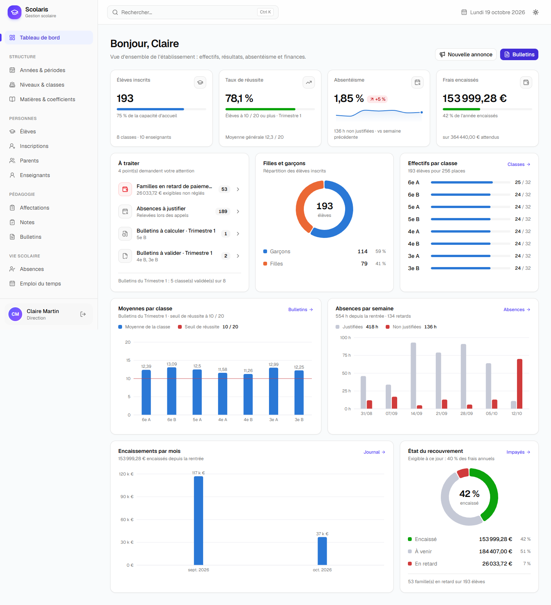

**En bref**

- API REST **Laravel 13** et SPA **React 19 + TypeScript**, séparées et déployables indépendamment.
- Logique métier dans des **services** testés : le calcul des bulletins est une classe pure couverte
  par des tests unitaires.
- Droits vérifiés côté serveur par des **Policies** : un professeur ne voit jamais les notes d'une
  classe où il n'enseigne pas, un parent ne voit que ses enfants. Ces règles sont testées.
- **≈ 255 tests PHPUnit** (unitaires et fonctionnels) et **36 tests Vitest**, plus des parcours
  navigateur rejoués avec Playwright pendant le développement.
- Jeu de démonstration réaliste : 193 élèves, 10 enseignants, emploi du temps complet sans conflit,
  plus de 7 000 notes, absences, paiements et bulletins validés.

## Sommaire

1. [Captures d'écran](#captures-décran)
2. [Fonctionnalités](#fonctionnalités)
3. [Architecture](#architecture)
4. [Modèle de données](#modèle-de-données)
5. [Installation locale](#installation-locale)
6. [Comptes de démonstration](#comptes-de-démonstration)
7. [Tests](#tests)
8. [Déploiement](#déploiement)
9. [Choix techniques](#choix-techniques)

## Captures d'écran

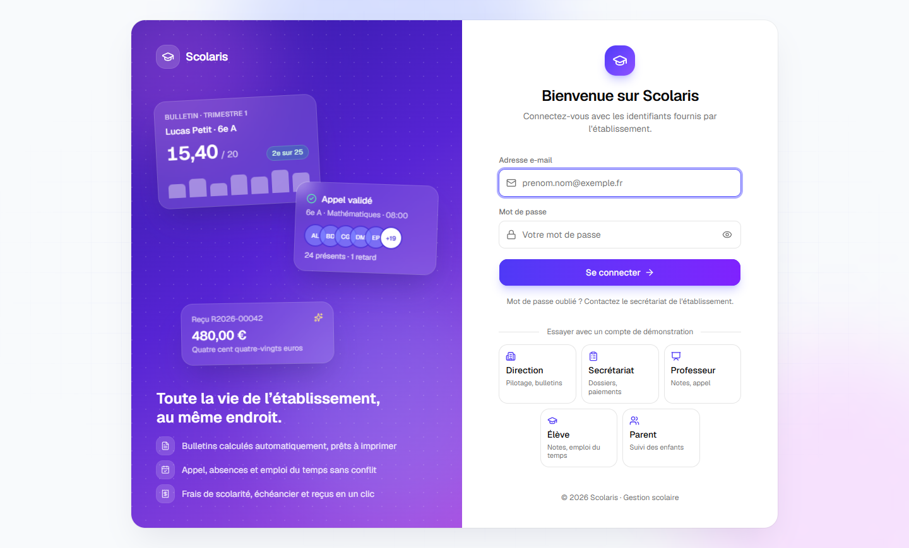

| | |
|---|---|
| 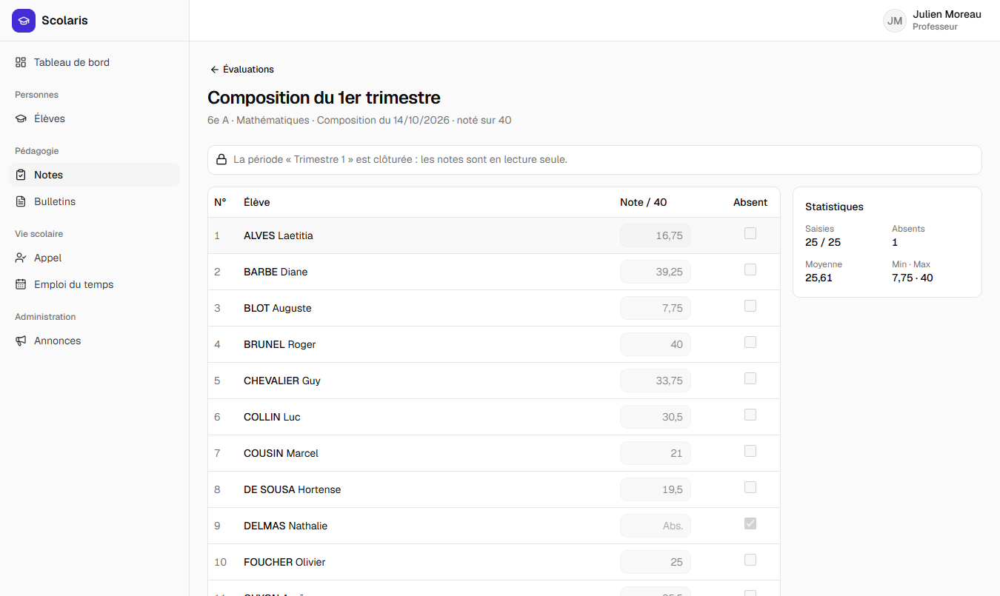 **Saisie des notes en grille** (navigation clavier, statistiques en direct) | 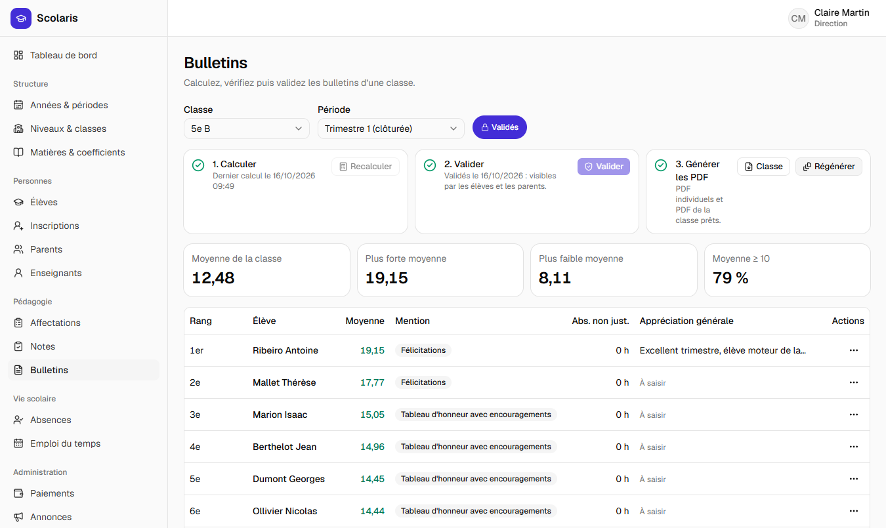 **Bulletins d'une classe** : calculer, valider, générer les PDF |
| 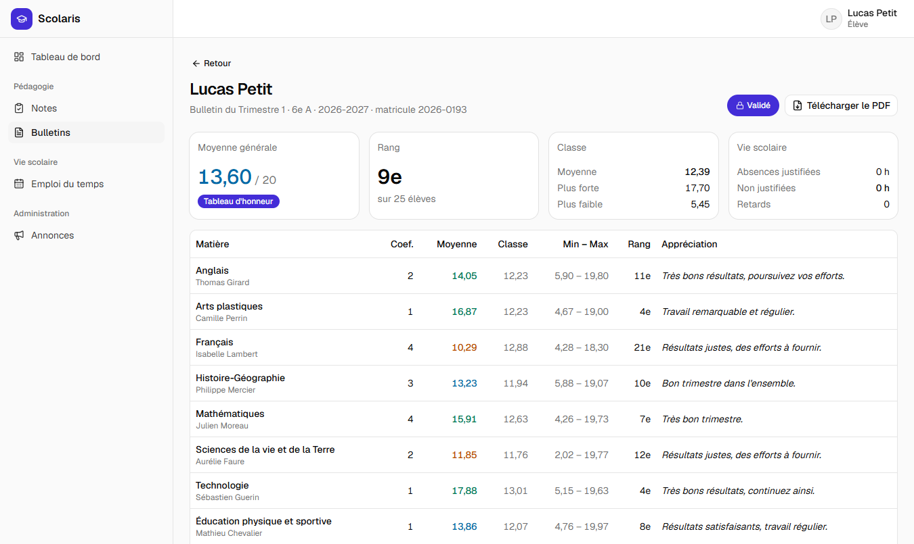 **Bulletin consulté par l'élève** | 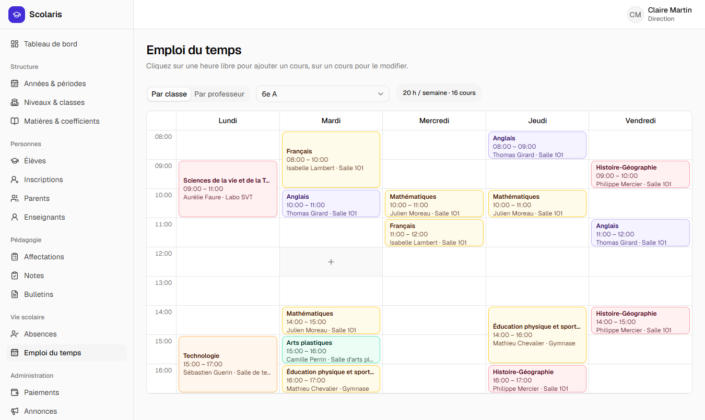 **Emploi du temps** d'une classe |
| 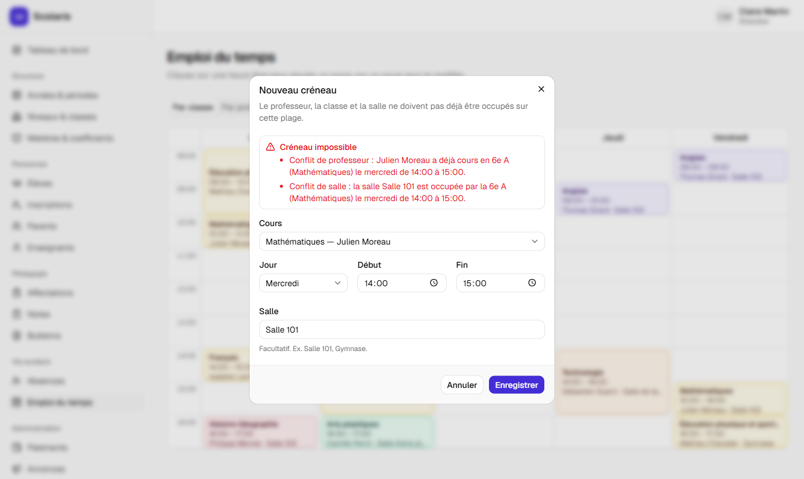 **Détection des conflits** (professeur, classe, salle) | 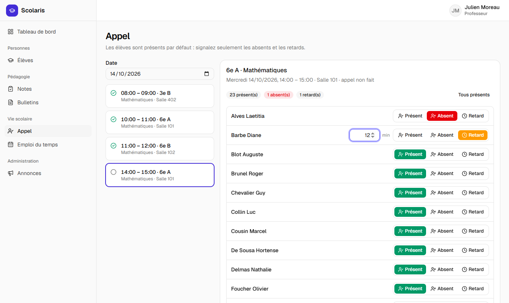 **Appel numérique** du professeur |
| 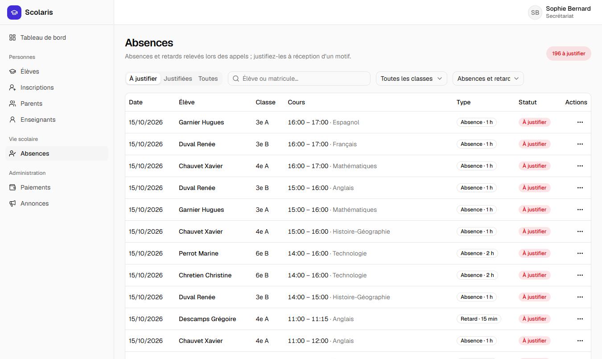 **Absences à justifier** (vie scolaire) | 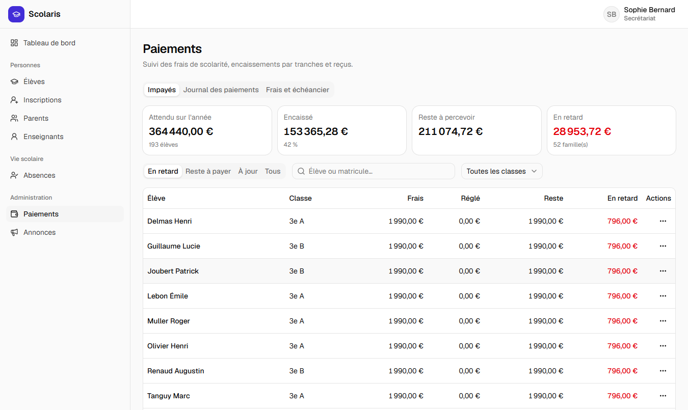 **Impayés** et totaux de l'année |
| 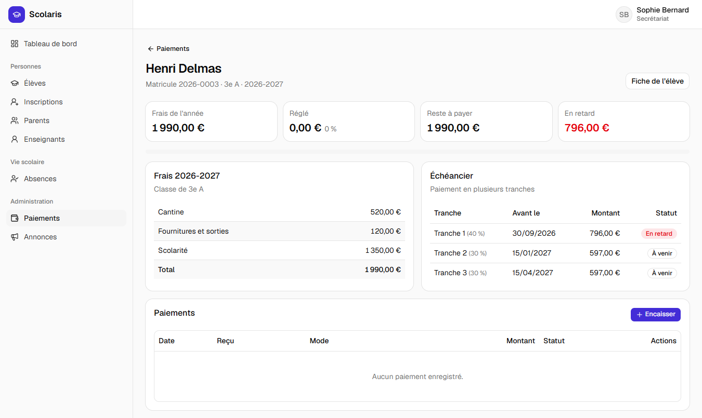 **Situation financière** d'un élève et échéancier | 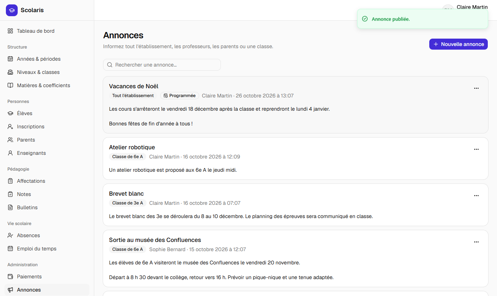 **Annonces ciblées** et programmées |
| 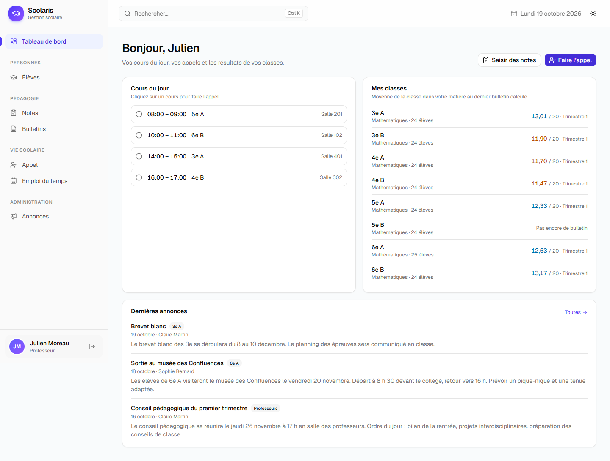 **Tableau de bord du professeur** | 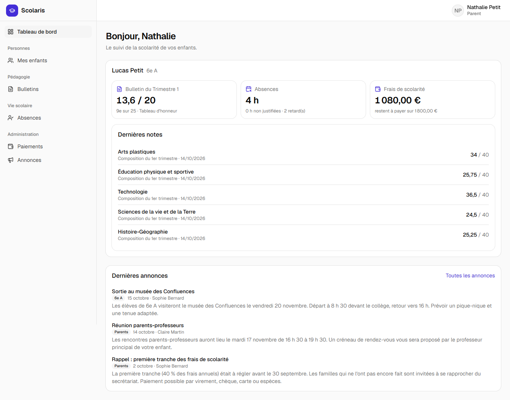 **Tableau de bord du parent** |

Exemples de documents générés : [bulletin PDF](docs/exemples/bulletin.pdf) · [reçu de paiement PDF](docs/exemples/recu.pdf).
L’interface est responsive ([tableau de bord sur mobile](docs/captures/03-tableau-de-bord-mobile.png)) et propose un thème clair, sombre ou celui du système ([mode sombre](docs/captures/18-mode-sombre.png)).

## Fonctionnalités

### Par profil

| Profil | Accès |
|---|---|
| **Direction** | Tout : années, périodes et clôture, niveaux, classes, matières et coefficients, affectations, emploi du temps, calcul et validation des bulletins, frais et échéancier, annonces, statistiques |
| **Secrétariat** | Dossiers élèves (photo, import Excel), parents, inscriptions, justification des absences, encaissements et reçus, annonces |
| **Professeur** | Ses classes uniquement : évaluations et notes, appréciations des bulletins, appel, emploi du temps |
| **Élève** | Ses notes, ses bulletins validés, son emploi du temps, ses absences |
| **Parent** | Ses enfants uniquement : notes, bulletins, absences, situation financière et reçus |

### Structure et personnes

- Une seule **année scolaire active** à la fois ; périodes sans chevauchement, clôturables.
- **Coefficients par niveau** : une même matière peut peser 4 en 6e et 5 en 3e.
- Élèves avec **matricule automatique** (`2026-0042`), photo servie par URL signée temporaire,
  liens multiples élève ↔ parents, archivage plutôt que suppression.
- **Import Excel / CSV** des élèves avec analyse préalable et rapport d'erreurs ligne par ligne.
- Inscription contrôlée (capacité de la classe, une inscription par élève et par année).

### Notes et bulletins (fonctionnalité phare)

Le calcul est isolé dans `MoyenneCalculator`, une classe pure sans accès à la base, couverte par
des tests unitaires. `BulletinService` l'orchestre.

- Chaque note est ramenée sur 20 ; moyenne par matière = **40 %** devoirs et interrogations
  + **60 %** composition (pondérations dans `config/bulletin.php`, surchargeables par `.env`).
  Si une catégorie est vide, l'autre compte seule.
- Un élève **absent** n'est compté ni comme zéro ni dans le diviseur ; une matière sans note est
  exclue de la moyenne générale (Σ moyenne × coefficient / Σ coefficients des matières notées).
- **Rangs** sur les valeurs non arrondies, ex æquo partagés (1, 2, 2, 4) ; moyennes stockées
  avec 4 décimales, affichées avec 2.
- Mentions selon des seuils configurables, statistiques de classe, rang par matière, heures
  d'absence justifiées ou non.
- Calcul possible uniquement sur une **période clôturée** ; un bulletin **validé** est figé
  (ni recalcul, ni appréciation, ni réouverture de la période).
- Appréciations par matière (professeur de la classe) et appréciation générale (direction).
- **PDF** individuel (mention « Projet » pour un brouillon) et génération **en lot par classe**
  dans un job de queue, avec un PDF regroupé pour l'impression.

### Vie scolaire

- **Emploi du temps** par classe ou par professeur. Un créneau qui chevauche un cours du même
  professeur, de la même classe ou dans la même salle est refusé, avec des messages précis
  (« la salle 101 est occupée par la 6e A (Mathématiques) le mercredi de 14:00 à 15:00 »).
- **Appel** du professeur sur ses seuls créneaux : présents par défaut, absents, retards en
  minutes ; l'appel est tracé même si tout le monde est présent.
- **Justification** par le secrétariat, pour une absence ou toute la journée de l'élève.

### Finances et communication

- **Frais par niveau** et **échéancier** de l'année (tranches en %, total 100 %). Après chaque date
  limite, la part exigible non réglée apparaît **en retard**.
- **Paiements par tranches** au montant libre, plafonné au reste à payer ; numéro de reçu
  séquentiel (`R2026-00001`) jamais réutilisé. Un paiement **s'annule** avec un motif mais ne se
  supprime pas : son reçu reste consultable avec la mention « Annulé ».
- **Reçu PDF** avec le montant en toutes lettres, liste des **impayés**, journal des encaissements.
- **Annonces** pour tout l'établissement, les professeurs, les parents ou une classe, publiées
  immédiatement ou programmées.

### Tableaux de bord

Un tableau de bord par profil, calculé côté serveur (`GET /api/tableau-de-bord`) :

- **direction** : effectifs par classe et par sexe, moyennes et taux de réussite par classe,
  absentéisme par semaine, encaissements par mois et état des paiements (graphiques Recharts) ;
- **secrétariat** : absences à justifier, familles en retard, derniers encaissements ;
- **professeur** : cours du jour, appels oubliés, moyenne de ses classes ;
- **élève et parent** : dernier bulletin, notes récentes, absences et, pour le parent, paiements.

## Architecture

```
scolaris/
├── backend/                       API REST Laravel 13
│   ├── app/
│   │   ├── Enums/                 rôles, permissions, types (évaluation, absence, paiement…)
│   │   ├── Http/Controllers/Api/  contrôleurs fins, regroupés par domaine
│   │   ├── Http/Requests/         validation (messages en français)
│   │   ├── Http/Resources/        format JSON des réponses
│   │   ├── Jobs/                  génération des PDF de bulletins par classe
│   │   ├── Models/                modèles Eloquent (attributs PHP 8 : Table, Fillable, UsePolicy)
│   │   ├── Policies/              autorisations par rôle et par périmètre
│   │   └── Services/              logique métier : Bulletins/, Finances/, VieScolaire/…
│   ├── database/                  migrations, factories, seeders de démonstration
│   ├── resources/views/pdf/       gabarits des bulletins et des reçus
│   └── tests/                     Unit/ (calculs purs) et Feature/ (API de bout en bout)
├── frontend/                      SPA React 19 + TypeScript
│   └── src/
│       ├── components/            composants réutilisables (tableau paginé, formulaires, modales)
│       ├── config/navigation.ts   source unique du menu et des routes protégées par rôle
│       ├── features/<domaine>/    api.ts (TanStack Query), types, schémas Zod, composants, pages
│       └── lib/                   client Axios (token, 401), formatage, téléchargements
├── docker/                        image PHP de développement, initialisation MySQL
└── docs/                          captures d'écran et exemples de PDF
```

**Flux d'une requête.** Route → Form Request (validation et autorisation) → contrôleur fin →
service métier → API Resource. Les règles métier enfreintes (période clôturée, bulletin validé,
paiement déjà annulé…) lèvent une `RegleMetierException` rendue en **409** avec un message en
français ; les erreurs de saisie répondent en **422**, champ par champ.

**Côté front**, chaque domaine regroupe son client API (hooks TanStack Query), ses types, ses
schémas Zod et ses écrans. Les calculs d'affichage (formatage des moyennes, rangs, montants,
placement des créneaux…) sont des fonctions pures testées avec Vitest ; les composants n'en
contiennent pas.

## Modèle de données

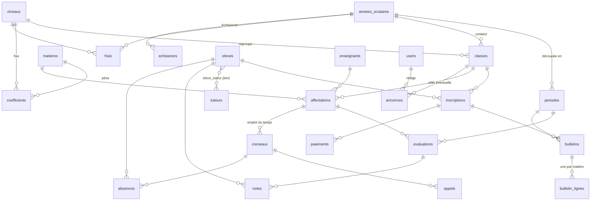

Principales contraintes : une inscription par élève et par année ; un enseignant par matière et
par classe ; une note par élève et par évaluation ; un bulletin par inscription et par période ;
un appel par créneau et par date ; numéro de reçu unique. Les comptes (`users`) sont reliés au
profil élève, parent ou enseignant ; rôles et permissions sont gérés par spatie/laravel-permission.

## Installation locale

Prérequis : **Docker Desktop** et **Node.js ≥ 20**. PHP 8.4 et MySQL 8.4 tournent dans des
conteneurs : aucune installation locale de PHP n'est nécessaire.

```bash
# 1. Backend : configuration et démarrage (API, MySQL, worker de la queue)
cp backend/.env.example backend/.env
docker compose run --rm api composer install
docker compose run --rm api php artisan key:generate
docker compose up -d
docker compose exec api php artisan migrate --database=central --path=database/migrations/central
docker compose exec api php artisan ecole:creer demo "Collège Jean Moulin" --demo

# 2. Frontend
cd frontend
cp .env.example .env.local
npm install
npm run dev
```

- Application : http://localhost:5173
- API : http://localhost:8001
- MySQL depuis l'hôte : `127.0.0.1:3307` (utilisateur `scolaris` / `secret`)
- Code de l'établissement à saisir à la connexion : **`demo`** (base `scolaris500001`)
- Réinitialiser la démonstration : `docker compose exec api php artisan migrate:fresh --seed`
  (agit sur `DB_DATABASE`, la base de l'école `demo`)

Le jeu de démonstration est calé sur la date du jour : l'année active est celle en cours, les
appels et absences vont de la rentrée à la veille, et le premier trimestre est clôturé (en avance
si besoin) pour montrer des bulletins. Classes « A » : bulletins validés ; 5e B : bulletins à
calculer ; autres classes : brouillons où les professeurs peuvent saisir leurs appréciations.

## Multi-établissement (une base par école)

Plusieurs écoles partagent la même application, chacune avec **sa propre base de données** :

- **Base centrale** `scolaris_central` : la liste des écoles (code, nom, base, active ou suspendue)
  et la file des tâches de fond.
- **Une base par école**, numérotée dans l'ordre de création : `scolaris500001`, `scolaris500002`…
  Elle contient toutes les tables métier, les comptes et les notifications de l'école.
- **Choix de l'école** : code saisi sur la page de connexion (mémorisé par le navigateur) ou
  sous-domaine (`lycee-andohalo.scolaris.mg`). Le front l'envoie dans l'en-tête `X-Ecole` ; l'API
  bascule alors sur la base de l'école avant toute authentification.
- **Isolation** : comptes, jetons, fichiers (`storage/app/private/ecoles/<code>`), cache, tâches
  de fond et relances quotidiennes s'exécutent dans le contexte de leur école.
- L'identité de l'école (nom, adresse, téléphone…) se modifie dans **Paramètres** par la direction.

Commandes d'exploitation :

```bash
docker compose exec api php artisan ecole:creer lycee-andohalo "Lycée Andohalo" --email=direction@lycee-andohalo.mg --mot-de-passe=...
docker compose exec api php artisan ecole:lister
docker compose exec api php artisan ecole:migrer               # après une mise à jour : base centrale + toutes les écoles
docker compose exec api php artisan ecole:suspendre lycee-andohalo  # --reactiver pour rouvrir l'accès
```

`ECOLES_MULTI=false` revient au fonctionnement à une seule école (base `DB_DATABASE`, sans code
à la connexion) ; c'est le mode des tests automatisés.

**Mettre à jour une installation existante (mono-école)** : la base `scolaris` est copiée dans
`scolaris500001` (l'ancienne reste en sauvegarde), puis rattachée comme école `demo`.

```bash
docker compose exec -T mysql mysql -uroot -proot < docker/mysql/init.sql
docker compose exec mysql sh -c 'mysql -uroot -proot -e "CREATE DATABASE scolaris500001" && mysqldump -uroot -proot scolaris | mysql -uroot -proot scolaris500001'
# backend/.env : DB_DATABASE=scolaris500001, DB_CENTRAL_DATABASE=scolaris_central,
#                DB_QUEUE_CONNECTION=central, ECOLES_MULTI=true
docker compose exec api php artisan config:clear
docker compose exec api php artisan migrate --database=central --path=database/migrations/central
docker compose exec api php artisan ecole:importer demo "Collège Jean Moulin" --base=scolaris500001
docker compose restart worker scheduler
```

## Comptes de démonstration

Mot de passe commun : **`password`** (les boutons de la page de connexion préremplissent chaque compte).

| Profil | E-mail | Pour essayer |
|---|---|---|
| Direction | `admin@scolaris.test` | Tableau de bord, bulletins de la 5e B à calculer, emploi du temps, frais |
| Secrétariat | `secretariat@scolaris.test` | Absences à justifier, impayés, encaissement et reçu |
| Professeur | `professeur@scolaris.test` | Julien Moreau, mathématiques dans les 8 classes : notes, appel, appréciations |
| Élève | `eleve@scolaris.test` | Lucas Petit (6e A) : notes, bulletin, emploi du temps |
| Parent | `parent@scolaris.test` | Nathalie Petit, mère de Lucas : bulletins, absences, paiements |

Les autres enseignants ont un compte `prenom.nom@scolaris.test` (ex. `carmen.roux@scolaris.test`).

## Tests

```bash
docker compose exec api php artisan test     # PHPUnit : unitaires + fonctionnels (base MySQL scolaris_test)
cd frontend && npm run test                  # Vitest : fonctions pures
npm run lint && npm run build                # oxlint, vérification TypeScript et build
```

- **Unitaires** : `MoyenneCalculator` (barèmes différents, absent, matière sans note, ex æquo,
  classe d'un seul élève, coefficients selon le niveau, mentions) et `MontantEnLettres`.
- **Fonctionnels** : chaque route est testée pour chaque rôle autorisé et refusé, avec les règles
  métier (période clôturée, bulletin validé, conflits d'emploi du temps, dépassement du reste à
  payer…).

## Déploiement

- **Frontend** (Vercel ou Netlify) : définir `VITE_API_URL`. Les fichiers `vercel.json` et
  `netlify.toml` gèrent la réécriture SPA.
- **Backend** (Render, AlwaysData…) : `backend/Dockerfile` construit une image Apache + PHP 8.4.
  Variables minimales : `APP_KEY`, `APP_URL`, `FRONTEND_URL`, `DB_*` ; `.env.example` est commenté.
  Le port est lu dans `$PORT` et les migrations s'exécutent au démarrage
  (`RUN_MIGRATIONS=false` pour les désactiver).
  En multi-établissement, le démarrage lance `ecole:migrer` et, si `ECOLE_DEMO_CODE` est défini,
  crée l'école de démonstration au premier lancement (en arrière-plan).
- **Démo gratuite** : `render.yaml` (Blueprint Render) décrit l'API ; MySQL chez un fournisseur
  qui autorise `CREATE DATABASE` (Aiven, TiDB Cloud). Certificat SSL du fournisseur dans
  `DB_SSL_CA_PEM`. Le service gratuit se met en veille après 15 min (premier appel ~1 min).
- **Sans worker permanent**, utiliser `QUEUE_CONNECTION=sync` : la génération des PDF d'une classe
  (~10 s pour 25 élèves) s'exécute alors dans la requête. Les PDF sont stockés sur le disque local
  du conteneur ; un PDF individuel disparu est régénéré à la demande.
- L'en-tête des documents (nom, adresse, ville, chef d'établissement) se modifie dans Paramètres ;
  les variables `ECOLE_*` servent de valeurs par défaut en mode école unique.
- **Avertissements de retard d'écolage** : la commande `php artisan scolaris:relancer-impayes`
  avertit chaque matin à 7 h les parents (une fois par tranche impayée) et envoie un récapitulatif
  à la direction et au secrétariat (cloche de l'application + e-mail, `MAIL_*`). En Docker, le
  service `scheduler` s'en charge ; ailleurs, planifier `php artisan schedule:run` chaque minute (cron).

## Choix techniques

- **Code en français**, tables et noms métier compris (`eleves`, `bulletins`, `tuteurs`…), pour
  rester au plus près du vocabulaire de l'établissement ; l'interface est en français.
- **Sanctum en mode token** (en-tête `Bearer`) : le front et l'API sont sur des domaines différents.
- **Montants en centimes** dans les calculs financiers, **moyennes à 4 décimales** en base :
  pas d'erreur d'arrondi, arrondi réservé à l'affichage.
- **Pas de suppression destructive** des données sensibles : élèves et enseignants archivés,
  paiements annulés avec motif, bulletins validés figés.
- **PDF en police Helvetica standard** (non embarquée) : environ 7 Ko et 0,3 s par bulletin.
- **Conflits métier en 409**, erreurs de saisie en 422, messages toujours en français.
